# ARQUITECTURA · Diseño de Sistema y Seguridad (PassTrack)

## 1. Tabla de Decisiones de Arquitectura

| # | Decisión | Alternativa descartada | Por qué | Fecha |
| :--- | :--- | :--- | :--- | :--- |
| **A-01** | Orquestación de 3 contenedores aislados (`db`, `PassTrack_backend`, `PassTrack_frontend`) unidos por una red bridge interna en Docker. | Ejecutar todos los servicios dentro de un solo contenedor o directamente en el sistema operativo host. | Garantiza reproducibilidad entre el entorno local y el servidor de Jenkins, aislando las dependencias de Java, Node y MySQL. | 2026-11-05 |
| **A-02** | Doble barrera de mínimo privilegio: autorización por rol en el filtro/controlador (`@PreAuthorize`) + verificación de propiedad de datos en la capa Service. | Validar el rol únicamente en el frontend de React ocultando botones del menú. | Protege la API ante peticiones directas realizadas con Postman/cURL utilizando un JWT válido pero perteneciente a otro usuario. | 2026-11-05 |
| **A-03** | Nginx en `PassTrack_frontend` actuando como servidor de estáticos y proxy inverso hacia `PassTrack_backend:8080`. | Exponer el backend en un dominio/puerto distinto sin proxy. | Evita problemas de CORS en producción y centraliza el tráfico HTTP por un único punto de entrada. | 2026-11-05 |
| **A-04** | Arquitectura Multicapa (Layered Architecture) en `PassTrack_backend`: Controlador, Servicio, Repositorio y Modelo. | Arquitectura Hexagonal (Puertos y Adaptadores) o estructura plana no jerárquica. | Garantiza un flujo unidireccional y directo para una API REST en Spring Boot 3; separa responsabilidades con claridad, simplifica el testing unitario y reduce la sobreingeniería. | 2026-11-06 |
| **A-05** | Arquitectura Basada en Funcionalidades (Feature-Based) y Patrón Contenedor / Presentacional (Smart & Dumb) en `PassTrack_frontend`. | Arquitectura MVVM completa o agrupación horizontal genérica por tipo de archivo (`components/`, `pages/`, `hooks/`). | Modula el frontend por dominios de negocio (`auth`, `asistencias`, `justificantes`) y desacopla la lógica/estado de la vista pura mediante props, favoreciendo mantenibilidad y pruebas. | 2026-11-06 |

## 2. Composición del Sistema (Cómo se Compone)

### 2.1 Diagrama de Flujo y Topología de Componentes

```mermaid
flowchart LR
    Client["Navegador Web"] -->|HTTP :80| Front["PassTrack_frontend (React + Nginx)"]
    
    subgraph Frontend["PassTrack_frontend (Feature-Based)"]
        Smart["Smart Containers (Estado / API)"] -->|Props| Dumb["Dumb Components (UI Pura)"]
        Provider["AuthContext (Provider Pattern)"] -.->|Sesion Global| Smart
        Axios["Axios Client (Interceptor JWT)"] -->|HTTP + Bearer| Nginx["Nginx Reverse Proxy"]
    end
    
    Front --> Axios
    Nginx -->|/api/*| Filter["JwtAuthenticationFilter (Chain of Responsibility)"]
    
    subgraph Backend["PassTrack_backend (Arquitectura Multicapa)"]
        Filter --> Ctrl["1. Controlador (@RestController + DTO Records)"]
        Ctrl -->|Inyeccion de Dependencias| Svc["2. Servicio (@Service + Reglas de Negocio)"]
        Svc -->|Repository Pattern| Repo["3. Repositorio (Spring Data JPA)"]
        Repo -->|Mapeo ORM| Model["4. Modelo (@Entity JPA)"]
    end
    
    Model -->|TCP :3306 Red Interna| DB[("MySQL 8.0 (Contenedor db)")]
    
    GitHub["GitHub Repo"] -->|Webhook Push| Jenkins["Jenkins CI/CD"]
    Jenkins -->|check.sh + docker compose| Front
    Jenkins -->|Build & Deploy| Backend
```

### 2.2 Flujo Multicapa del Backend: Desde el Controlador hasta el Modelo

El backend implementa un flujo secuencial estricto y unidireccional donde cada capa tiene responsabilidades delimitadas, prohibiéndose el salto de niveles intermedios:

1. **Filtro de Seguridad (`JwtAuthenticationFilter` - Chain of Responsibility):**
   Intercepta la solicitud entrante en el `SecurityFilterChain`, valida criptográficamente el token JWT y establece la identidad en el `SecurityContext` de Spring Security antes de alcanzar el endpoint.
2. **Capa Controlador (`controller/`):**
   Los controladores (`@RestController`) exponen los endpoints REST y aplican control de acceso basado en roles con `@PreAuthorize`. Reciben datos de entrada mediante **DTOs inmutables implementados con Java Records** (ej. `LoginRequestRecord`, `AsistenciaCreateRecord`), protegiendo la aplicación de vulnerabilidades de *Mass Assignment*. Los controladores **únicamente interactúan con la capa de Servicio** a través de **Inyección de Dependencias** (`@Autowired` o constructor).
3. **Capa Servicio (`service/`):**
   Anotada con `@Service`, contiene la lógica de negocio pura, la orquestación transaccional (`@Transactional`) y la validación de propiedad de datos (doble barrera de seguridad). Transforma los DTOs de entrada en Entidades del Modelo y mapea los resultados hacia DTOs de respuesta (`ResponseRecord`). Es la **única capa autorizada para comunicarse con los Repositorios**.
4. **Capa Repositorio (`repository/` - Repository Pattern):**
   Interfaces que extienden de `JpaRepository` de Spring Data JPA. Abstraen las operaciones de acceso y persistencia en base de datos, encapsulando consultas SQL/JPQL y permitiendo un desacoplamiento que facilita el testeo mediante mocks (`Mockito`).
5. **Capa Modelo (`model/`):**
   Clases marcadas con `@Entity` de JPA/Hibernate (ej. `Usuario`, `Grupo`, `Asistencia`, `Justificante`) que representan el esquema y relaciones del dominio de datos relacional persistido en el contenedor `db` (MySQL 8.0).

### 2.3 Arquitectura Frontend: Feature-Based y Contenedor / Presentacional

En lugar de una estructura genérica o MVVM compleja, el frontend se estructura para maximizar la cohesión del dominio:

* **Estructura Feature-Based:** El código reside en `src/features/<modulo>/` (ej. `auth`, `asistencias`, `justificantes`), conteniendo los componentes, servicios y hooks propios de cada funcionalidad.
* **Smart Components (Contenedores):** Gestionan el estado del componente, ejecutan llamadas asíncronas con Axios y manejan eventos de negocio, pasando los datos transformados a los componentes visuales.
* **Dumb Components (Presentacionales):** Componentes declarativos de interfaz de usuario desacoplados de la lógica; reciben datos vía `props` y notifican eventos mediante callbacks.
* **Provider Pattern (Context API):** `AuthContext` administra el estado global de autenticación, usuario en sesión y roles decodificados, eliminando el *prop drilling*.
* **Interceptor Pattern (Axios):** Cliente HTTP centralizado que inyecta automáticamente el token JWT (`Authorization: Bearer <token>`) en cada petición saliente y captura respuestas `401`/`403` para redirigir oportunamente a la pantalla de login.